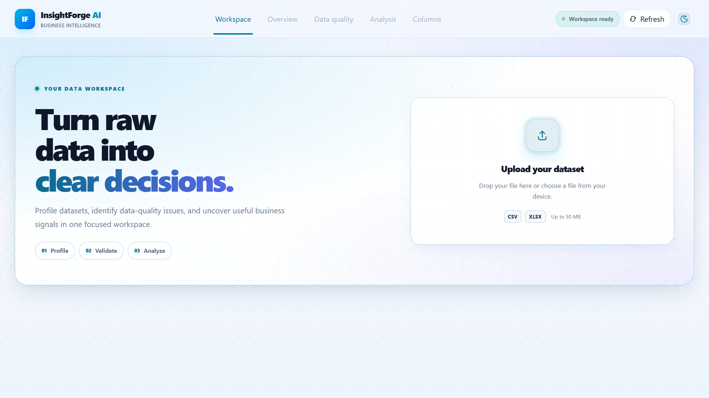
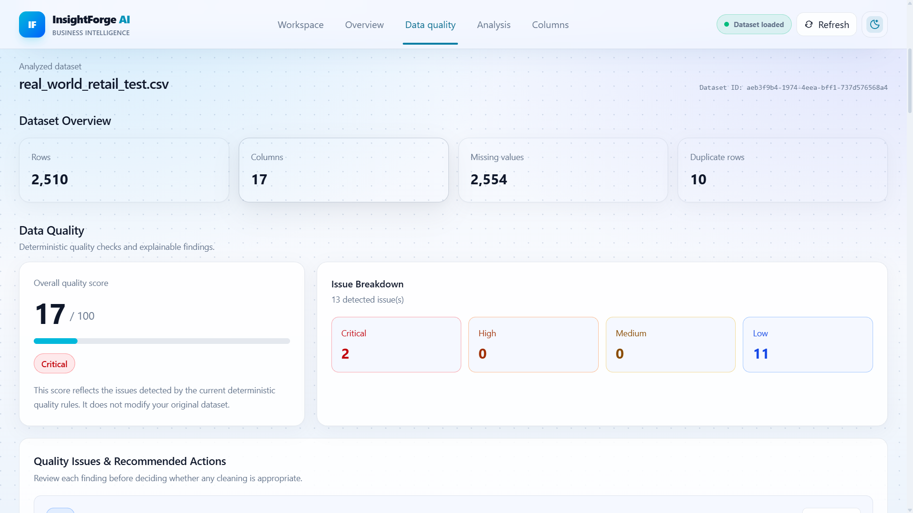
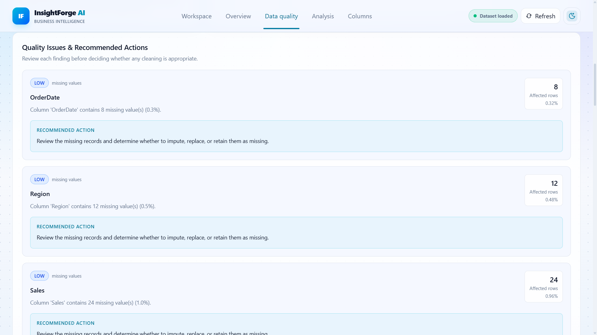
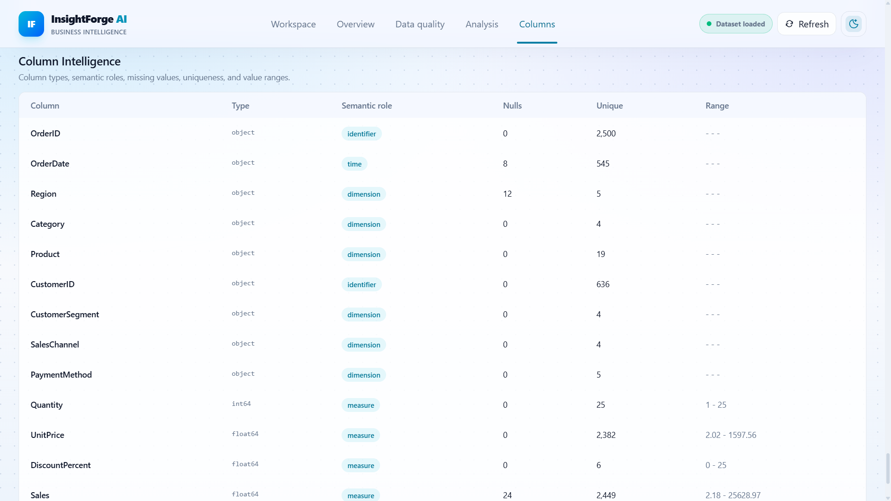
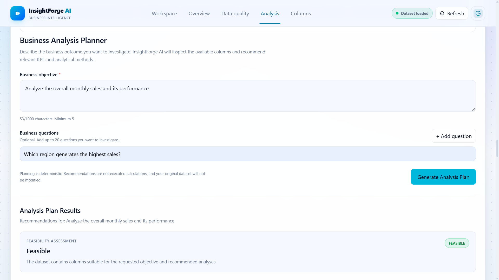
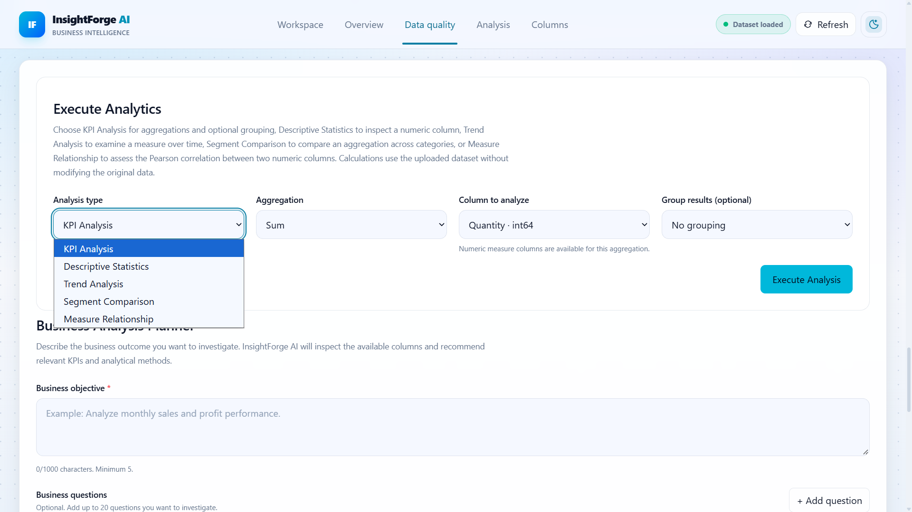
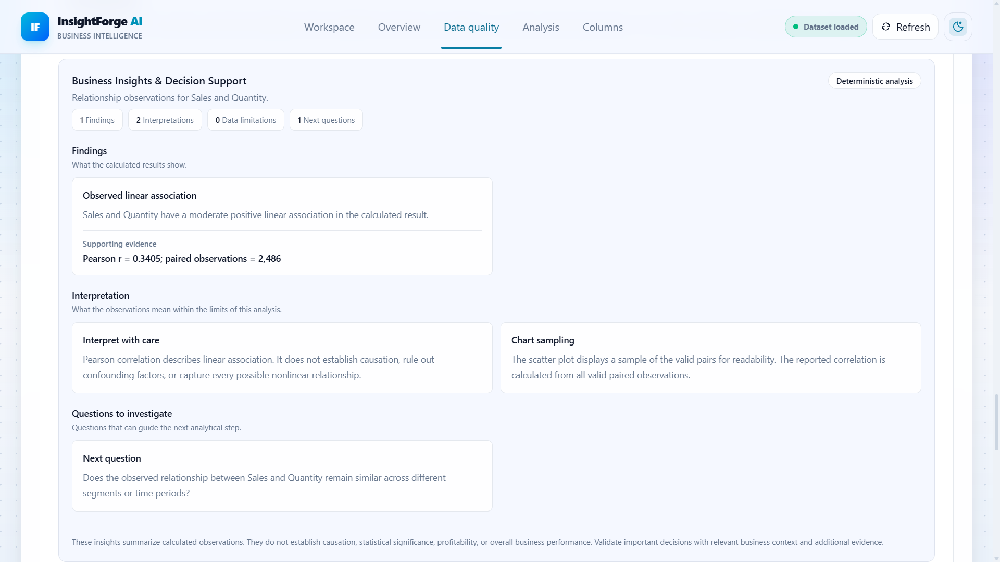

# InsightForge AI

### AI-Powered Business Analytics & Decision Intelligence Platform

<p align="center">
  <strong>From Raw Data to Meaningful Business Insights</strong>
</p>

<p align="center">
  <a href="https://insightforge-ai-sigma.vercel.app/">Live Application</a> •
  <a href="https://insightforge-ai-r64p.onrender.com/docs">API Documentation</a> •
  <a href="https://github.com/M-Shafeek06/insightforge-ai">Source Code</a>
</p>

---

## Overview

**InsightForge AI** is a business analytics and decision intelligence platform designed to simplify the process of transforming raw datasets into structured analytical results and business-oriented insights.

The platform brings together dataset ingestion, data profiling, data-quality assessment, analytical execution, visualization, and business analysis planning within a unified application.

It follows a structured analytical workflow:

**Understand → Clean → Analyze → Visualize → Explain → Decide**

The objective is to help users understand their data, identify potential quality issues, perform analytical operations, visualize findings, and interpret results in a business context.

**Project Status:** MVP implemented and deployed.

---

## Live Application

| Component         | Link                                                                 |
| ----------------- | -------------------------------------------------------------------- |
| Web Application   | [Open InsightForge AI](https://insightforge-ai-sigma.vercel.app/)    |
| Backend API       | [API Endpoint](https://insightforge-ai-r64p.onrender.com)            |
| API Documentation | [FastAPI Swagger UI](https://insightforge-ai-r64p.onrender.com/docs) |
| GitHub Repository | [View Source Code](https://github.com/M-Shafeek06/insightforge-ai)   |

---

## Application Preview

### 1. Application Interface



### 2. Dataset Overview



### 3. Data Quality Assessment



### 4. Column Intelligence



### 5. Business Analysis Planner



### 6. Analytical Results



### 7. Business Insights



---

## Core Features

### 1. Dataset Ingestion & Profiling

* Upload datasets in CSV and Excel formats.
* Examine dataset dimensions and column information.
* Inspect column data types and semantic roles.
* Review missing-value distributions.
* Generate dataset profiling information.

### 2. Data Quality Assessment

The platform performs deterministic data-quality checks to identify potential issues in uploaded datasets.

Implemented checks include:

* Missing-value detection.
* Duplicate-row identification.
* Empty-column detection.
* Constant-column identification.
* Date-like values stored as text.
* Invalid date values.
* High-cardinality columns.
* Data-quality severity classification.

The assessment presents quality findings, scores, and recommended actions to help users understand potential data issues before analysis.

### 3. Business Analysis Planner

The Business Analysis Planner helps users translate business objectives into structured analytical approaches.

Capabilities include:

* Submit a business objective.
* Evaluate the objective against available dataset information.
* Identify relevant dataset columns.
* Recommend suitable KPIs.
* Suggest analytical approaches.
* Highlight relevant data-quality warnings.

**Important:** Analysis planning and analytical execution are separate operations. Planner recommendations do not represent completed calculations.

### 4. Analytical Operations

The platform supports the following analytical operations:

| Analytical Operation   | Description                                                                  |
| ---------------------- | ---------------------------------------------------------------------------- |
| KPI Analysis           | Perform aggregations and optional group-by analysis.                         |
| Descriptive Statistics | Examine numerical distributions and summary statistics.                      |
| Trend Analysis         | Analyze measures across time periods.                                        |
| Segment Comparison     | Compare aggregated measures across categories.                               |
| Measure Relationship   | Examine relationships between numerical variables using Pearson correlation. |

### 5. Data Visualization

* Present analytical results through charts and tables.
* Visualize trends and category comparisons.
* Examine numerical relationships.
* Explore calculated analytical results.

### 6. Business Insights

The platform generates business-oriented interpretations based on calculated analytical results.

These include:

* Findings derived from analytical observations.
* Interpretations supported by calculated results.
* Data-quality limitations affecting interpretation.
* Potential missing-value implications.
* Suggested follow-up business questions.

Insights should be interpreted within the relevant business context. They do not independently establish causation, statistical significance, or overall business performance.

---

## Technology Stack

The project uses the following technologies.

### Frontend

| Technology     | Purpose               |
| -------------- | --------------------- |
| Next.js 16     | Frontend framework    |
| React 19       | UI development        |
| TypeScript     | Type-safe development |
| Tailwind CSS 4 | Styling               |
| Plotly         | Data visualization    |
| Vitest         | Frontend testing      |

### Backend

| Technology  | Purpose                      |
| ----------- | ---------------------------- |
| Python 3.12 | Backend development          |
| FastAPI     | REST API development         |
| Pydantic    | Data validation              |
| Pandas      | Data processing and analysis |
| PyArrow     | Columnar data processing     |
| DuckDB      | Analytical query execution   |
| SQLAlchemy  | Database interaction         |
| PostgreSQL  | Database infrastructure      |
| psycopg     | PostgreSQL connectivity      |

### Testing & Infrastructure

* pytest
* Vitest
* Docker Compose
* PostgreSQL integration infrastructure
* Next.js production build

### Deployment

| Component               | Platform   |
| ----------------------- | ---------- |
| Frontend                | Vercel     |
| Backend                 | Render     |
| Database Infrastructure | PostgreSQL |

---

## System Architecture

InsightForge AI follows a separated frontend and backend architecture.

The frontend handles user interactions and visualization, while the backend manages dataset processing, quality assessment, and analytical operations.

### Application Workflow

```text
                 USER
                   |
                   v
            NEXT.JS FRONTEND
           TypeScript + React
                   |
                   v
          NEXT.JS API ROUTES
                   |
                   v
            FASTAPI BACKEND
                   |
          +--------+--------+
          |                 |
          v                 v
    DATASET PROFILING   DATA QUALITY
          |                 |
          +--------+--------+
                   |
                   v
           ANALYTICAL SERVICES
                   |
          +--------+--------+
          |                 |
          v                 v
      KPI ANALYSIS     STATISTICAL
                       ANALYSIS
          |                 |
          +--------+--------+
                   |
                   v
             VISUALIZATION
                   |
                   v
            BUSINESS INSIGHTS
                   |
                   v
          ANALYSIS RECOMMENDATIONS
```

The implemented analytical workflows use deterministic data-processing and calculation operations. Analysis-planner recommendations are handled separately from analytical execution.

---

## Repository Structure

```text
insightforge-ai/
│
├── backend/
│   ├── app/
│   │   ├── api/
│   │   ├── schemas/
│   │   ├── services/
│   │   └── main.py
│   │
│   ├── tests/
│   └── requirements.txt
│
├── frontend/
│   ├── app/
│   ├── components/
│   ├── lib/
│   └── package.json
│
├── data/
│   └── samples/
│
├── docs/
│   └── architecture/
│
├── scripts/
│
├── .env.example
├── docker-compose.yml
└── README.md
```

---

## Installation & Local Setup

Follow these steps to run the project locally.

### Prerequisites

Ensure that the following tools are installed:

* Python 3.12
* Node.js
* npm
* Git
* Docker Desktop (for the provided PostgreSQL infrastructure, when required)

### 1. Clone the Repository

```bash
git clone https://github.com/M-Shafeek06/insightforge-ai.git

cd insightforge-ai
```

### 2. Backend Setup

Navigate to the backend directory:

```bash
cd backend
```

Create a virtual environment:

```bash
python -m venv .venv
```

Activate the environment.

**Windows PowerShell:**

```powershell
.\.venv\Scripts\Activate.ps1
```

Install dependencies:

```bash
python -m pip install -r requirements.txt
```

Configure the required environment variables according to the backend configuration.

Start the FastAPI server:

```bash
uvicorn app.main:app --reload
```

Backend API:

```text
http://127.0.0.1:8000
```

API Documentation:

```text
http://127.0.0.1:8000/docs
```

### 3. Frontend Setup

Open another terminal and navigate to the frontend directory from the repository root:

```bash
cd frontend
```

Install dependencies:

```bash
npm install
```

Start the development server:

```bash
npm run dev
```

Access the application using the local URL displayed by Next.js.

Configure the frontend API routing and environment variables according to the existing project configuration.

### 4. Database Infrastructure

If your local configuration requires PostgreSQL, start the configured services from the repository root:

```bash
docker compose up -d
```

Ensure that the required database environment variables are configured.

---

## Testing

### Backend Tests

From the backend directory:

```bash
python -m pytest -q
```

### Frontend Tests

From the frontend directory:

```bash
npm test
```

### Production Build

From the frontend directory:

```bash
npm run build
```

These commands can be used to reproduce the project's automated checks. Successful execution depends on the installed dependencies and environment configuration.

The deployed application has also been manually exercised using multiple datasets.

---

## Data Handling & Analytical Considerations

The platform incorporates several considerations to support responsible data analysis:

* Data-quality findings are generated using deterministic rules.
* Missing values are distinguished from valid numerical values during supported analytical operations.
* Grouped aggregations report relevant row and value counts.
* Planner recommendations are not represented as completed calculations.
* Pearson correlation indicates association, not causation.
* Small datasets may limit the reliability and interpretability of statistical analyses.
* Data-quality scores represent the implemented assessment rules, not an absolute measure of business readiness.

Important findings should always be validated against the relevant business context before making decisions.

---

## Current Project Scope

The current MVP focuses on:

1. Dataset ingestion.
2. Dataset profiling.
3. Deterministic data-quality assessment.
4. Business analysis planning.
5. Analytical execution.
6. Data visualization.
7. Business-oriented insights.

The deployed application has been tested against multiple datasets, including sample datasets and larger retail datasets.

### Potential Future Improvements

The following are possible extensions rather than claims about existing functionality:

* More advanced data-cleaning workflows.
* Improved statistical feasibility checks.
* Enhanced dataset persistence.
* Additional decision-support capabilities.
* Expanded analytical operations.

---

## Project Objective

The primary objective of InsightForge AI is to simplify the analytical journey from raw datasets to meaningful business understanding.

By combining data profiling, quality assessment, analytical execution, visualization, and business-oriented interpretation, the platform aims to provide a structured environment for exploring data and supporting informed decisions.

---

## Author

**M Shafeek**

B.Tech – Artificial Intelligence & Data Science
Dhaanish Ahmed Institute of Technology

**Professional Focus:** Data Analytics | Business Intelligence | Data-Driven Decision Making

| Platform  | Profile                                                 |
| --------- | ------------------------------------------------------- |
| Portfolio | [m-shafeek06.github.io](https://m-shafeek06.github.io/) |
| GitHub    | [M-Shafeek06](https://github.com/M-Shafeek06)           |
| LinkedIn  | [M Shafeek](https://www.linkedin.com/in/m-shafeek)      |
| Email     | [shafeekm529@gmail.com](mailto:shafeekm529@gmail.com)   |

---

<p align="center">
  <strong>InsightForge AI</strong>
  <br>
  From Raw Data to Clearer Business Decisions.
</p>